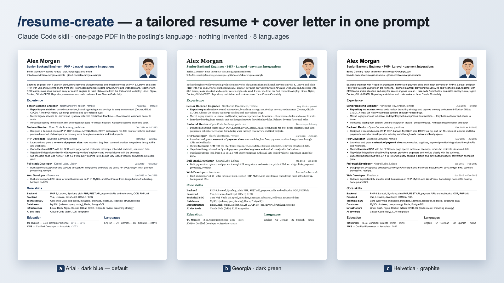
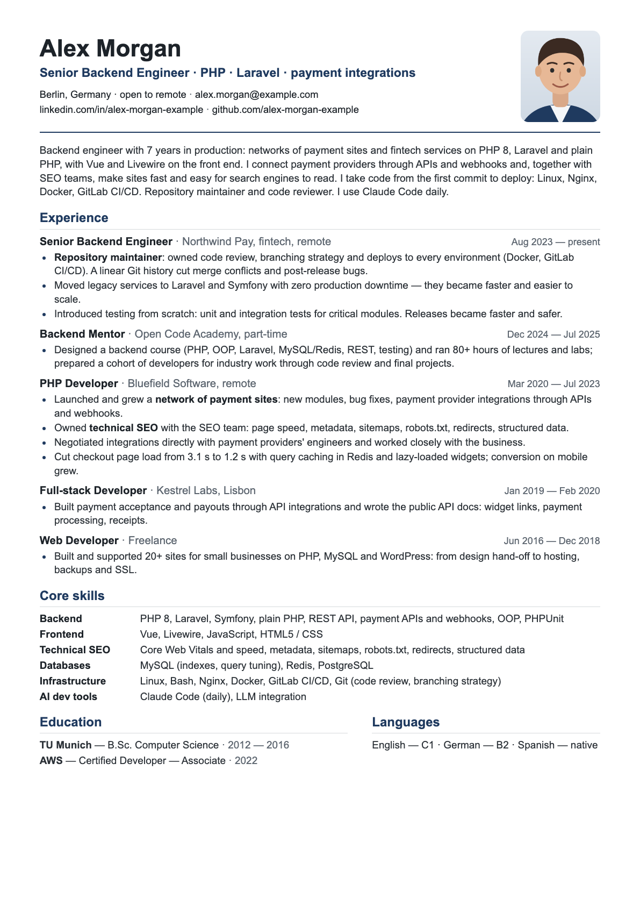
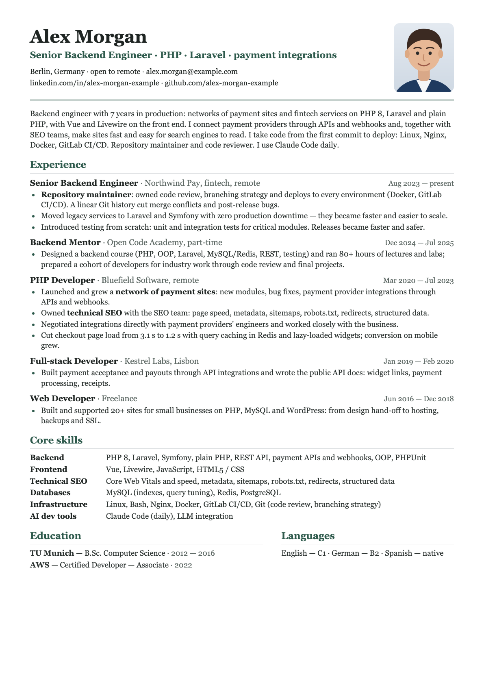
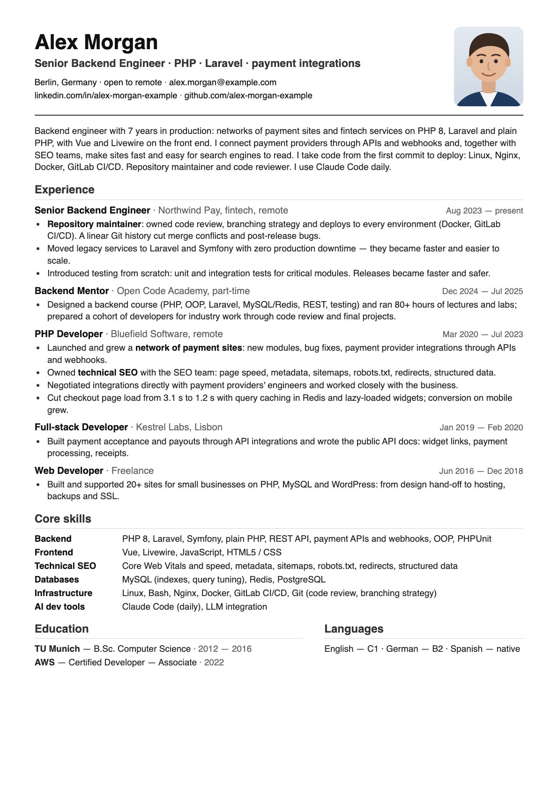

# resume-create — tailor your resume to any job in one prompt

**A Claude Code skill that turns your resume and one job posting into a one-page, recruiter-ready PDF and a short cover letter, in the language of the posting, without inventing a single fact.**



```
/resume-create ~/Downloads/my_cv.pdf https://jobs.example.com/senior-backend-engineer
```

Five minutes later you have:

- `~/Downloads/Alex_Morgan_Backend_Northwind_EN.pdf` — one page, every bullet answering a requirement of *this* posting;
- `~/Downloads/northwind_cover_letter_en.txt` — 120–200 words, no "dynamic team" filler, ready to paste.

## Why people use it

**It asks instead of lying.** The skill compares the posting with your resume and asks which of the missing requirements you actually did — in one multi-choice question. Only confirmed skills go in. You will never have to explain at an interview something an AI made up.

**It writes like a senior, not like a template.** Role or result first, active voice, "what → how → what changed". *"My team lead appointed me maintainer"* becomes *"**Repository maintainer**: owned code review, branching strategy and deploys"*. Numbers are never rounded up.

**It speaks the posting's language.** A German posting gets a German resume and letter, a Ukrainian one — Ukrainian. Built-in section labels and month formats for English, German, Polish, Czech, Spanish, French, Ukrainian and Russian; any other language works with four custom labels.

**The design is backed by research, not taste.** Recruiters spend [about 7.4 seconds](https://www.hrdive.com/news/eye-tracking-study-shows-recruiters-look-at-resumes-for-7-seconds/) on the first pass, and the TheLadders eye-tracking study found multi-column layouts and dense text hurt. So: one column, bold titles, clear headings, Arial (top 3 in a 1,003 hiring-manager survey), dark blue (the colour that [inspires the most trust](https://aisel.aisnet.org/mwais2007/16)). Sources are in [`design-research.md`](skills/resume-create/references/design-research.md).

**One page, always.** The build script shrinks the layout step by step until it fits on A4 and then *looks at the result* — a lone word on the last line or a cropped photo gets fixed before you see it.

**Real text, zero setup.** The PDF is printed by headless Chrome: selectable text, single column, system fonts. Needs only Python 3 and Chrome, Chromium or Edge — no pip packages, no LaTeX, no SaaS account.

**It was shaped by real applications.** Every step in the skill is an answer to a correction a real candidate made: no "my boss gave me", no rejected styles offered again, a "checked" from you before the hand-off is final.

## Install

**As a plugin** (command becomes `/resume-create:resume-create`):

```
claude plugin marketplace add MarkForest/resume-create
claude plugin install resume-create@markforest-resume-create
```

**As a personal skill** (command is just `/resume-create`):

```
git clone https://github.com/MarkForest/resume-create /tmp/resume-create
cp -r /tmp/resume-create/skills/resume-create ~/.claude/skills/
```

Or with the [skills CLI](https://skills.sh): `npx skills add MarkForest/resume-create --skill resume-create`

## Use

In any Claude Code session:

```
/resume-create ~/Downloads/my_cv.pdf https://jobs.example.com/12345
```

Or just talk to it — the skill triggers on its own:

- "here's the job, here's my CV, make an application"
- "help me apply to Northwind Pay"
- "adapt my resume for this posting and translate it to German"
- «вот вакансия, вот моё резюме — сделай отклик» / «адаптуй резюме під вакансію»

No resume path? It finds the newest `*resume*` / `*cv*` file in Downloads, Documents and Desktop and asks before using it.

## Three themes

| `a` — default | `b` | `c` |
| --- | --- | --- |
|  |  |  |
| Arial, dark blue `#1f3a5f`. Won a side-by-side comparison | Georgia, dark green. Warmer and more formal | Helvetica, graphite. For banks, law and other conservative employers |

Say "show me another look" and Claude shows `b` and `c` instead of inventing a random style. Photo is optional: `"photo": null` for the US and UK, where photos are not expected.

## How it works

1. **Inputs** — reads your resume (PDF with layout, DOCX or text) and the posting (text or link).
2. **Posting analysis** — language, must-haves, nice-to-haves, first-months goals, the words the company repeats.
3. **Gaps** — one multi-select question: which missing requirements did you really do? Plus location and format.
4. **Rewrite** — headline named after the role, 4–6 line summary, bullets that close requirements, irrelevant stuff cut.
5. **PDF** — content goes to `content.json`, [`build_resume.py`](skills/resume-create/scripts/build_resume.py) renders it, Claude checks the preview image.
6. **Cover letter** — greeting, why you match, 3–4 "what I can bring" bullets mapped to requirements, their goal in your words, call to talk.
7. **Hand-off** — paths, what changed, what you must check yourself, and it waits for your "checked".

Sources stay in `~/Documents/resume-src/<company>-<YYYY-MM>/`, so the next edit takes a minute.

## Build a PDF without Claude

The renderer is a plain script — useful for CI or if you keep your resume as JSON:

```
python3 skills/resume-create/scripts/build_resume.py skills/resume-create/assets/example-content.json --out resume.pdf --preview preview.png --theme a
```

Schema: [`content-schema.md`](skills/resume-create/references/content-schema.md). Set `CHROME_PATH` if Chrome is not found.

## Author

Hi, I'm **Anatolii Marchenko** — a full-stack developer who builds products end to end with Claude Code as an engineering team: spec, plan, subagent-driven development with review, CI deciding what reaches production. My latest product, [TourSearch](https://markforest.github.io/toursearch/), is a multi-operator tour search platform built solo this way and running in production.

I build Claude Code skills, agent workflows and full-stack products (PHP / Laravel, Vue / TypeScript, PostgreSQL, Docker). **Need something like this for your team or product? Let's talk.**

- Portfolio: https://markforest.github.io
- LinkedIn: https://www.linkedin.com/in/anatoliimarchenko/
- Telegram: [@mark4rest](https://t.me/mark4rest)
- Email: amarchenkodev@gmail.com

More skills by me: [normalize-prompt](https://github.com/MarkForest/normalize-prompt) — turn a rambling prompt into a compact engineering prompt, on any model.

**If this skill landed you an interview, star the repo ⭐ and tell me — I collect the stories.**

## Українською

Скіл для Claude Code: з вашого резюме й однієї вакансії робить одну сторінку PDF, яку рекрутер прочитає за 7 секунд, і коротке супровідне — мовою вакансії. Нічого не вигадує: чого немає в резюме, про те питає одним запитанням із варіантами. Дизайн обрано за дослідженнями рекрутерів (одна колонка, Arial, темно-синій), PDF завжди вміщується на одну сторінку. Потрібні лише Python 3 і Chrome.

Встановлення — вище. Запуск: `/resume-create <шлях до резюме> <посилання на вакансію>` або просто «адаптуй резюме під цю вакансію».

## На русском

Скилл для Claude Code: из вашего резюме и одной вакансии делает одностраничный PDF, который рекрутер прочитает за 7 секунд, и короткое сопроводительное — на языке вакансии. Ничего не выдумывает: чего нет в резюме, о том спрашивает одним вопросом с вариантами. Дизайн выбран по исследованиям рекрутеров (одна колонка, Arial, тёмно-синий), PDF всегда помещается на одну страницу. Нужны только Python 3 и Chrome.

Установка — выше. Запуск: `/resume-create <путь к резюме> <ссылка на вакансию>` или просто «вот вакансия, вот моё резюме — сделай отклик».

## License

MIT, see [LICENSE](LICENSE). The example candidate "Alex Morgan" and all companies in the example are fictional.
